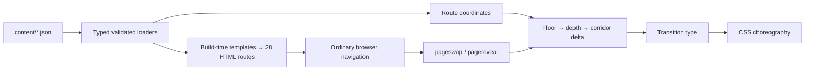

# DMNS · After Hours

A static, accessible concept redesign of the Denver Museum of Nature & Science. Twenty-eight prerendered routes turn the museum into a coordinate system: enter a hall, walk along a corridor, or move between floors. Real collection photography is intentionally represented by labeled duotone plates.

## Run

Requires Node 22.18+ (tested on 24.18.0).

```sh
npm ci
npx playwright install chromium firefox webkit
npm run dev
```

Open http://127.0.0.1:4173. `npm run build` writes `dist/`; it is generated and never edited by hand. Deploy that directory to Netlify using the included `netlify.toml`, `_redirects` and `_headers`.

```sh
npm run check     # strict types, ESLint, units, build, contrast, links, 3-engine e2e, Lighthouse
npm run audit     # Lighthouse: Atrium, Directory, Prehistoric Journey; fails budgets
npm run record    # regenerate the 60-second keyboard walkthrough
```

The audit and recording commands start a local static server when needed. The build date uses the Denver calendar; `BUILD_DATE=2026-10-30 npm run build` allows deterministic notice/coming-state previews. Rebuild for the current date before shipping.

## Architecture



TypeScript compiles to native ES modules; there is no runtime framework or router. Custom Elements progressively enhance the light DOM. All route content is server-rendered at build time. The theme control cycles After Hours → Daylight → system preference; the default is After Hours. The small parser-blocking preference script prevents a theme/motion flash; the render-blocking module installs the incoming transition listener before its first snapshot.

The Directory's selected floor is a real query coordinate (`/halls/?floor=3`), resolving the brief's conflicting `enter` vs `ascend` examples. Gems and Minerals uses a virtual, unconfirmed threshold; no physical floor is asserted. See [motion-spec.md](docs/motion-spec.md).

## Verification artifacts

- [Verification record](docs/verification.md)
- [Browser support and limits](docs/browser-support.md), [actual engine probes](docs/engine-verification.json)
- [Generated contrast table](docs/contrast.md), [asset budgets](docs/budgets.json)
- [Lighthouse results](docs/performance.json) and HTML reports in `docs/audits/`
- [60-second keyboard walkthrough](docs/keyboard-walkthrough.webm)
- [Desktop Atrium](docs/atrium-desktop.png), [mobile Atrium](docs/atrium-mobile.png), [Directory](docs/directory-desktop.png), [hall](docs/hall-desktop.png)

Lighthouse is a mobile lab simulation, not a physical Moto G Power or a field INP measurement. The exact method and limitations are recorded in the reports.

## Content to confirm with DMNS

All pending data uses the literal `TODO: confirm with DMNS` and a visible dashed label. The supplied snapshot is dated October 16, 2026; its facts are not silently updated from unrelated live-site material.

- Physical floor of Gems and Minerals; its renovation schedule and final text.
- Collection-object selection, object names, accession/metadata lines, detail descriptions and approved photographs/credits for every hall.
- Exhibition descriptive copy not supplied in the brief; Gates Planetarium and Laser Shows descriptive copy.
- Dates and details of all seeded events; program descriptions and logistics.
- School Programs, About and Support editorial copy; visit pricing/accessibility/getting-here/eat-and-shop details beyond the supplied facts.
- Approved full land acknowledgment text. The concept currently marks this pending and links directly to the exact live footer rather than substituting a paraphrase.
- Official DMNS logo file. The wordmark is the requested typographic placeholder.

Official ticketing, membership, donation, login, search, Catalyst and Digital Collections remain outbound links with an external-link arrow. Cart hands off to official ticketing because no independent live cart URL was verified. No commerce, accounts, analytics or third-party runtime scripts are included. The newsletter is a local concept interaction: it sends and saves no entered information.

The build validates JSON and escapes interpolated HTML. Source citations and facts live alongside content or in the documentation. Newsreader and Jost Latin WOFF2 files are self-hosted with their licenses. Image format support is ready for AVIF/WebP `<picture>` sources, explicit dimensions, lazy loading and a single high-priority hero; no fabricated collection image is used.
